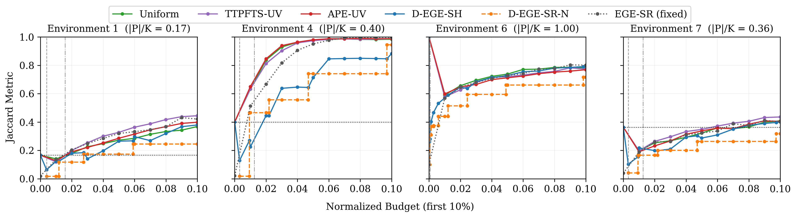

# Early-curve artifacts in the publication figures

This report investigates the behavior of the first evaluation points of the
Jaccard, Bernoulli, and misidentification curves. **No figure was changed**:
the information-matched figures use the same conventions as the existing
publication figures. All numbers below come from the validated data in
`results_information_matched_e3b913e5e6cd` and from the preregistered results.
Data tables are in this directory (`*.csv`), and the diagnostic plot is
`early_curve_artifacts.png`.

The figure shows mean Jaccard over the first 10% of the budget. Markers are
evaluation points. The dotted horizontal line is |P|/K, the dashed vertical
line is K/B, and the dash-dotted vertical line is 4K/B, the end of the
TTPFTS and APE-UV warm-up.

## M1 – zero-information recommendation at t = 0 (affects every anytime curve)

Before any pull, all empirical (and posterior) means are zero. No arm then
strictly dominates another, so **every anytime algorithm recommends all K
arms** at t = 0. The t = 0 point therefore measures the zero-information
convention, not learning: Jaccard = |P|/K, Bernoulli = 1 exactly when every
arm is Pareto-optimal, and misidentification = (K − |P|)/K.
This holds exactly for every anytime curve (Uniform, APE, APE-UV, TTPFTS-KV,
TTPFTS-UV, the empirical-mean D-EGE) and for fixed-budget EGE-SH:
**verified**. Fixed-budget EGE-SR at T = 0
instead returns a single random arm, with t = 0 Jaccard between
0.004 and 0.160.

| Env | K | |P| | |P|/K | Jaccard(t=0) | Bernoulli(t=0) | Uniform Jaccard(first grid) | first grid / B | 4K > first grid |
|---|---|---|---|---|---|---|---|---|
| 1 | 60 | 10 | 0.167 | 0.167 | 0.000 | 0.140 | 0.010 | yes |
| 2 | 10 | 2 | 0.200 | 0.200 | 0.000 | 0.283 | 0.010 | yes |
| 3 | 200 | 20 | 0.100 | 0.100 | 0.000 | 0.218 | 0.010 | no |
| 4 | 50 | 20 | 0.400 | 0.400 | 0.000 | 0.632 | 0.010 | yes |
| 5 | 20 | 4 | 0.200 | 0.200 | 0.000 | 0.411 | 0.010 | no |
| 6 | 10 | 10 | 1.000 | 1.000 | 1.000 | 0.590 | 0.010 | no |
| 7 | 22 | 8 | 0.364 | 0.364 | 0.000 | 0.197 | 0.010 | yes |
| 8 | 5 | 1 | 0.200 | 0.200 | 0.000 | 0.424 | 0.010 | no |

Consequences:
- **Environment 6** has |P| = K, so every anytime curve starts at a
  *perfect* score (Jaccard = Bernoulli = 1, misidentification = 0). The score
  then drops to about 0.59
  at the first grid point.
- **Environment 7** (|P|/K = 0.36) starts at 0.36 and dips to about
  0.20.

  Both shapes are artifacts of the t = 0 convention, not of learning. Where
  |P|/K is small, the t = 0 point instead lies below the first informed
  point, so no dip appears.

## M2 – native EGE classifies arms that were never sampled (D-EGE-N stages, fixed-budget EGE)

The native implementations initialize means to zero and classify arms even
when the budget leaves them unsampled:
- EGE-SR draws nothing at T ≤ K, because its allocation `n_k` is
  `ceil((T − K)/…) = 0`. It rejects every arm except a random survivor.
- EGE-SH gives zero pulls per arm in its first round whenever
  T < K·⌈log₂K⌉. It then dismisses half of the arms on randomly tie-broken
  zero means.

Arms classified without a single sample, listed per doubling stage s as
"zero-sample arms / K":

| Env | algorithm | stage: arms classified without a sample |
|---|---|---|
| 1 | EGE_SH | s1: 52/60, s2: 45/60, s3: 30/60 |
| 1 | EGE_SR | s1: 60/60 |
| 2 | EGE_SH | s1: 8/10, s2: 5/10 |
| 2 | EGE_SR | s1: 10/10 |
| 3 | EGE_SH | s1: 175/200, s2: 150/200, s3: 100/200 |
| 3 | EGE_SR | s1: 200/200 |
| 4 | EGE_SH | s1: 43/50, s2: 37/50, s3: 25/50 |
| 4 | EGE_SR | s1: 50/50 |
| 5 | EGE_SH | s1: 17/20, s2: 15/20, s3: 10/20 |
| 5 | EGE_SR | s1: 20/20 |
| 6 | EGE_SH | s1: 8/10, s2: 5/10 |
| 6 | EGE_SR | s1: 10/10 |
| 7 | EGE_SH | s1: 19/22, s2: 16/22, s3: 11/22 |
| 7 | EGE_SR | s1: 22/22 |
| 8 | EGE_SH | s1: 5/5, s2: 2/5 |
| 8 | EGE_SR | s1: 5/5 |

The first D-EGE-SR-N stage (budget K) is therefore always a single random
arm. This is why the D-EGE-SR-N curves start near zero. The first two to
three D-EGE-SH-N stages partly dismiss arms at random.

The same mechanism affects the original fixed-budget EGE curves at their
first grid budgets: 1 (EGE_SH, T = 152: 45/60), 1 (EGE_SH, T = 304: 30/60), 2 (EGE_SH, T = 25: 5/10), 4 (EGE_SH, T = 160: 25/50), 7 (EGE_SH, T = 70: 11/22).

## M3 – warm-up still covers the first grid point (no defect, but identical curves)

TTPFTS (both variants) and APE-UV spend their first 4K pulls on a
round-robin warm-up, and APE spends its first K pulls the same way. Where
4K exceeds the first grid point (the `4K > first grid` column above), these
algorithms are still sampling uniformly at that point. Their first informed
points are therefore Uniform in distribution. For example, in Environment 7
at t = 70, the mean Jaccard values are TTPFTS-KV 0.197, TTPFTS-UV 0.197, Uniform 0.197, although the individual
recommendations differ. This explains coinciding early curves; it is not an
implementation fault.

## M4 – zero-initialized unsampled arms (empirical-mean D-EGE)

Because of M2, the empirical-mean D-EGE has unsampled arms during its first
stages. Under the production convention, an unsampled arm keeps a zero mean,
which is the same rule as Uniform and APE. The counterfactual below re-runs
the stages with identical samples and excludes unsampled arms from the
empirical Pareto set. It covers every evaluation point up to 5% of B.

| Env | algorithm | partially sampled states | of which recommend an unsampled arm | mean J (zero) | mean J (exclude) | max |ΔJ| in one state |
|---|---|---|---|---|---|---|
| 1 | D_EGE_SH | 600 | 0 | 0.147 | 0.147 | 0.000 |
| 1 | D_EGE_SR | 0 | 0 | 0.180 | 0.180 | 0.000 |
| 2 | D_EGE_SH | 300 | 20 | 0.291 | 0.289 | 0.900 |
| 2 | D_EGE_SR | 0 | 0 | 0.311 | 0.311 | 0.000 |
| 3 | D_EGE_SH | 300 | 0 | 0.274 | 0.274 | 0.000 |
| 3 | D_EGE_SR | 0 | 0 | 0.282 | 0.282 | 0.000 |
| 4 | D_EGE_SH | 500 | 0 | 0.427 | 0.427 | 0.000 |
| 4 | D_EGE_SR | 0 | 0 | 0.617 | 0.617 | 0.000 |
| 5 | D_EGE_SH | 300 | 2 | 0.379 | 0.379 | 0.200 |
| 5 | D_EGE_SR | 0 | 0 | 0.387 | 0.387 | 0.000 |
| 6 | D_EGE_SH | 200 | 13 | 0.588 | 0.581 | 0.800 |
| 6 | D_EGE_SR | 0 | 0 | 0.655 | 0.655 | 0.000 |
| 7 | D_EGE_SH | 500 | 1 | 0.233 | 0.233 | 0.270 |
| 7 | D_EGE_SR | 0 | 0 | 0.279 | 0.279 | 0.000 |
| 8 | D_EGE_SH | 100 | 0 | 0.391 | 0.391 | 0.000 |
| 8 | D_EGE_SR | 0 | 0 | 0.379 | 0.379 | 0.000 |

A "partially sampled state" is a repetition and evaluation point at which
some, but not all, arms are unsampled. With means in [0, 1], a zero mean is
dominated by almost every sampled arm, so the two conventions rarely differ.
The largest difference in mean early Jaccard between the conventions is
0.0074. Across all 100 repetitions of every environment, the last
evaluation point with any unsampled arm lies at 3.00% of B,
well inside the 5% horizon. Beyond it the two conventions are identical.

## Pull order within rounds (empirical-mean D-EGE sensitivity)

The empirical-mean curves interleave each round's pulls round-robin. Native
block order (arm by arm) would place every sample of the lower-index arms
first. The largest difference between the mean Jaccard curves of the two
orders is:

| Env | algorithm | max_abs_mean_jaccard_difference | normalized_budget_of_max | final_difference |
|---|---|---|---|---|
| 1 | D_EGE_SH | 0.022 | 0.100 | 0.000 |
| 1 | D_EGE_SR | 0.022 | 0.270 | -0.001 |
| 2 | D_EGE_SH | 0.056 | 0.130 | 0.007 |
| 2 | D_EGE_SR | 0.046 | 0.030 | -0.003 |
| 3 | D_EGE_SH | 0.021 | 0.390 | 0.003 |
| 3 | D_EGE_SR | 0.008 | 0.620 | 0.001 |
| 4 | D_EGE_SH | 0.023 | 0.050 | 0.001 |
| 4 | D_EGE_SR | 0.005 | 0.110 | 0.000 |
| 5 | D_EGE_SH | 0.029 | 0.140 | -0.003 |
| 5 | D_EGE_SR | 0.028 | 0.060 | 0.004 |
| 6 | D_EGE_SH | 0.014 | 0.920 | -0.001 |
| 6 | D_EGE_SR | 0.021 | 0.060 | 0.010 |
| 7 | D_EGE_SH | 0.025 | 0.450 | 0.005 |
| 7 | D_EGE_SR | 0.042 | 0.880 | -0.014 |
| 8 | D_EGE_SH | 0.040 | 0.190 | 0.005 |
| 8 | D_EGE_SR | 0.050 | 0.060 | -0.015 |

## M5 – log-scale misidentification omits exact zeros

On log axes an exact zero cannot be drawn.
- **Omitted means:** an exact-zero mean is silently omitted. This happens at
  7 environment/algorithm combinations
  (6/APE, 6/APE-UV, 6/D-EGE-SH, 6/D-EGE-SR, 6/TTPFTS-KV, 6/TTPFTS-UV, 6/Uniform),
  all at the very start of the curves.
- **Bands reaching the axis floor:** a positive mean whose interval lower
  bound is clipped to 0 makes the shaded band run to the bottom of the axis.
  This affects 4 combinations. The mean line is still drawn.

| Env | algorithm | issue | points | first | last | figure_sets |
|---|---|---|---|---|---|---|
| 4 | D_EGE_SH_N | band reaches axis floor (lower bound 0) | 22 | 0.798 | 1.000 | kv_both,kv_naive,uv_both,uv_naive |
| 4 | D_EGE_SR | band reaches axis floor (lower bound 0) | 5 | 0.370 | 1.000 | kv_both,uv_both |
| 4 | D_EGE_SR_N | band reaches axis floor (lower bound 0) | 64 | 0.397 | 1.000 | kv_both,kv_naive,uv_both,uv_naive |
| 4 | TTPFTS_UNKNOWN_VAR | band reaches axis floor (lower bound 0) | 5 | 0.940 | 1.000 | uv_both,uv_naive |
| 6 | APE | mean omitted (exact zero) | 1 | 0.000 | 0.000 | kv_both,kv_naive |
| 6 | APE_UV | mean omitted (exact zero) | 1 | 0.000 | 0.000 | uv_both,uv_naive |
| 6 | D_EGE_SH | mean omitted (exact zero) | 1 | 0.000 | 0.000 | kv_both,uv_both |
| 6 | D_EGE_SR | mean omitted (exact zero) | 2 | 0.000 | 0.000 | kv_both,uv_both |
| 6 | TTPFTS_KNOWN_VAR | mean omitted (exact zero) | 1 | 0.000 | 0.000 | kv_both,kv_naive |
| 6 | TTPFTS_UNKNOWN_VAR | mean omitted (exact zero) | 1 | 0.000 | 0.000 | uv_both,uv_naive |
| 6 | Uniform | mean omitted (exact zero) | 1 | 0.000 | 0.000 | kv_both,kv_naive,uv_both,uv_naive |

## Remedy options (not applied)

1. **Treat t = 0 as a convention.** Either start every curve at the first
   grid point, or draw t = 0 as a separate, explicitly labelled marker.
   This removes the Environment 6 spike and the Environment 7 dip, and it
   leaves every informed point unchanged.
2. **Compare after a common initialization budget.** This could be max(4K)
   across algorithms, or an early-budget inset with a logarithmic x-axis, so
   that warm-up phases (M3) are visible rather than hidden in the first 1–2%
   of the axis.
3. **Disclose native EGE behavior at small budgets.** This applies to
   fixed-budget EGE at T = 0 and the first one to three doubling stages
   (M2). Options are a caption note, or starting the D-EGE curves at the
   first stage that samples every arm. Changing EGE itself would no longer
   be the published algorithm.
4. **State the unsampled-arm rule explicitly** (M4). Its effect is
   quantified above.
5. **Mark exact zeros on log axes** (M5), for example with a clipped floor
   marker or a symlog axis, instead of omitting them.
